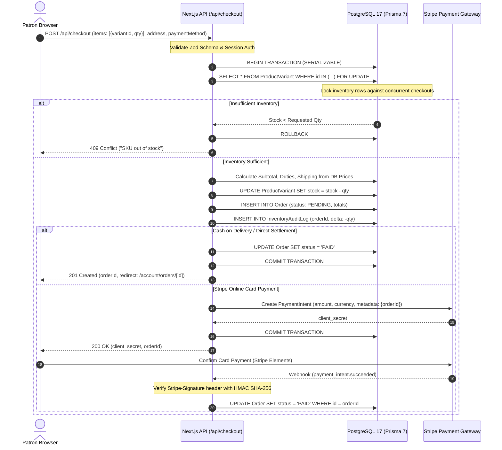
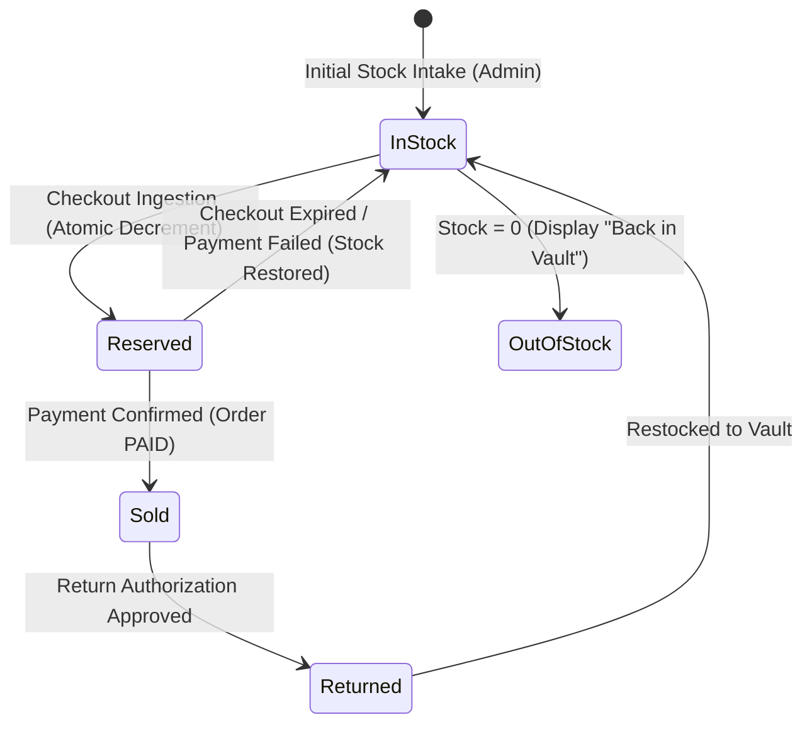
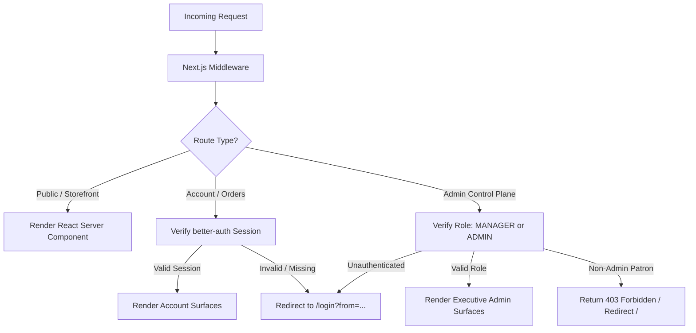

# NEXORA — System Architecture & Engineering Blueprint

**Date of Execution:** October 2026  
**Auditing Team:** Principal Product Engineer, Staff Software Architect, Application Security Engineer  
**Scope:** Complete Architecture Blueprint, Data Flow, Security Topology, and State Invariants.

---

## 1. System Overview & Technology Stack

NEXORA is engineered as a high-performance, server-authoritative digital commerce platform. It leverages a modern TypeScript stack built on **Next.js 16 (App Router with Turbopack)**, **React 19**, **PostgreSQL 17**, and **Prisma ORM 7**.

```
┌────────────────────────────────────────────────────────────────────────┐
│                              CLIENT TIER                               │
│  React 19 (Server/Client Components) · Tailwind CSS v4 · Radix UI      │
│  useSyncExternalStore (Currency & Hydration) · Zustand (Local Bag)     │
└───────────────────────────────────┬────────────────────────────────────┘
                                    │ HTTPS / HTTP2 / Server Actions
┌───────────────────────────────────▼────────────────────────────────────┐
│                           APPLICATION TIER                             │
│  Next.js 16 App Router (Node.js 24 Runtime)                            │
│  ├─ Middleware: Role-Based Access Control (CUSTOMER / MANAGER / ADMIN) │
│  ├─ API Routes: Server-Authoritative Quotes, Idempotent Checkout       │
│  ├─ Better-Auth v1.7: Secure Session & Identity Lifecycle              │
│  └─ Stripe Node SDK v23: Signature-Verified Webhook Ingestion          │
└───────────────────────────────────┬────────────────────────────────────┘
                                    │ Pool Connection (@prisma/adapter-pg)
┌───────────────────────────────────▼────────────────────────────────────┐
│                            DATA STORAGE                                │
│  PostgreSQL 17 on Port 5432 (Prisma 7.10 ORM)                          │
│  ├─ Atomic Transactions (SERIALIZABLE / REPEATABLE READ)               │
│  ├─ Inventory Audit Ledger & Stock Decrement Constraints               │
│  └─ Relational Integrity (Users, Products, Orders, Reviews, Sessions)  │
└────────────────────────────────────────────────────────────────────────┘
```

---

## 2. Server-Authoritative Money & Checkout Flow

To eliminate client-side price tampering and race conditions, NEXORA enforces a strict server-authoritative money flow:
1. The client sends only SKU IDs and desired quantities to `POST /api/cart/quote` or `POST /api/checkout`.
2. Prices, discounts, tax rates, and shipping tiers are resolved directly against PostgreSQL catalog records.
3. Client-provided prices, subtotals, or currency conversions are discarded.



---

## 3. Inventory Ledger State Machine

Inventory is treated as a double-entry ledger rather than a mutable integer counter without history. Every mutation writes to `InventoryAuditLog`:



### Invariant Rules
- `stock >= 0`: Enforced via PostgreSQL `CHECK (stock >= 0)` constraint.
- Zero overselling: Atomic decrements use `WHERE stock >= requested_quantity`.
- Traceability: Every quantity modification references an `orderId`, `adminUserId`, or `systemReconciliationId`.

---

## 4. Client State vs Server State Separation

NEXORA adheres to strict boundaries between ephemeral client state and persistent server state:

### 1. Local Shopping Bag (Zustand)
- Stores only: `variantId`, `quantity`, and UI drawer visibility state (`isOpen`).
- Persists to `localStorage` under `nexora_bag_v1`.
- When rendered or checked out, the client queries `POST /api/cart/quote` to fetch live prices, stock availability, and currency conversions.

### 2. Multi-Currency Synchronization (`useSyncExternalStore`)
- Currency preference (`USD`, `EUR`, `GBP`) is stored in `localStorage`.
- Traditional React state synchronization via `useEffect` was refactored to React 19's `useSyncExternalStore` in `components/currency/currency-provider.tsx` and `components/product/price.tsx`.
- **Benefit:** Zero cascading renders, elimination of `react-hooks/set-state-in-effect` lint errors, and zero hydration mismatch warnings.

### 3. Server Actions & App Router Cache
- Product listings, category pages, and search queries are executed as asynchronous React Server Components (RSC).
- Mutations (e.g. review submission, order status update, address deletion) execute via Server Actions or typed API endpoints with `revalidatePath` and `revalidateTag` for immediate cache invalidation.

---

## 5. Security & Authentication Architecture



### Security Measures Implemented
1. **CSRF & Origin Protection:** Next.js Server Actions automatically validate origin headers. Better-Auth validates cross-site request tokens.
2. **Password Masking & Reveal:** `components/auth/login-form.tsx` uses standard HTML password masking with an accessible button (`aria-label={showPassword ? "Mask input" : "Reveal input"}`).
3. **Stripe Webhook Verification:** `app/api/webhooks/stripe/route.ts` verifies incoming webhook payloads using `stripe.webhooks.constructEvent(body, signature, secret)` with constant-time cryptographic HMAC verification.
4. **Zod Input Validation:** All API endpoints validate request bodies using strict Zod schemas with `.strip()` or `.strict()` to prevent prototype pollution and parameter injection.
5. **Security Headers:** Configured in `next.config.ts`:
   - `X-Frame-Options: DENY` (Clickjacking prevention)
   - `X-Content-Type-Options: nosniff` (MIME sniffing prevention)
   - `Referrer-Policy: strict-origin-when-cross-origin`
   - `Permissions-Policy: camera=(), microphone=(), geolocation=()`

---

## 6. Database Schema Topology (PostgreSQL 17 & Prisma 7)

```
┌─────────────────────────────────┐       ┌─────────────────────────────────┐
│              User               │       │             Address             │
├─────────────────────────────────┤       ├─────────────────────────────────┤
│ id: String (cuid, PK)           │1     *│ id: String (cuid, PK)           │
│ email: String (unique)          ├───────┤ userId: String (FK)             │
│ name: String                    │       │ street, city, country, postal   │
│ role: Enum (CUSTOMER, ADMIN...) │       │ isDefault: Boolean              │
└────────────────┬────────────────┘       └─────────────────────────────────┘
                 │1
                 │*
┌────────────────▼────────────────┐       ┌─────────────────────────────────┐
│              Order              │1     *│            OrderItem            │
├─────────────────────────────────┤───────├─────────────────────────────────┤
│ id: String (cuid, PK)           │       │ id: String (cuid, PK)           │
│ userId: String (FK)             │       │ orderId: String (FK)            │
│ status: Enum (PENDING, PAID...) │       │ variantId: String (FK)          │
│ totalAmount: Int (cents)        │       │ quantity: Int, price: Int       │
│ paymentMethod: String           │       └─────────────────────────────────┘
└────────────────┬────────────────┘
                 │1
                 │*
┌────────────────▼────────────────┐       ┌─────────────────────────────────┐
│       InventoryAuditLog         │       │         ProductVariant          │
├─────────────────────────────────┤       ├─────────────────────────────────┤
│ id: String (cuid, PK)           │       │ id: String (cuid, PK)           │
│ orderId: String (FK)            │*     1│ productId: String (FK)          │
│ variantId: String (FK)          ├───────┤ sku: String (unique)            │
│ delta: Int                      │       │ stock: Int (check >= 0)         │
│ reason: String                  │       │ price: Int (cents)              │
└─────────────────────────────────┘       └─────────────────────────────────┘
```

---

## 7. Performance & Caching Strategy

| Route Category | Rendering Strategy | Caching Behavior | Invalidation Trigger |
|---|---|---|---|
| `/` (Storefront Home) | Static (SSG) / ISR | Cached at Edge, revalidated every 60s | Product update in Admin |
| `/shop` (Catalog) | Dynamic RSC | Query-cached with deterministic search indexes | Price / Stock update |
| `/product/[slug]` (PDP) | Static (SSG) / Dynamic | Pre-rendered for known slugs, ISR 300s | `revalidatePath('/product/[slug]')` |
| `/cart` | Client + Server Quote | Dynamic fetch (`cache: 'no-store'`) | Every quantity change |
| `/checkout` | Client Dynamic | No caching; live pricing & inventory check | Real-time |
| `/admin/*` | Dynamic (SSR) | Private; never cached at edge CDN | Authenticated request |
