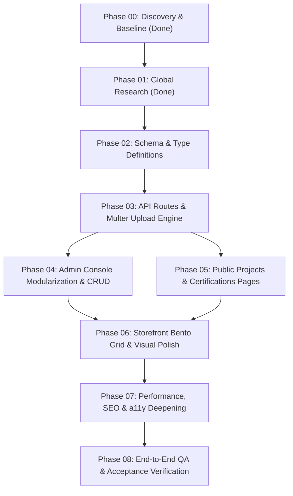

# NEXORA — Master Development Plan & Execution Roadmap
**Phase 08 Deliverable — Comprehensive Engineering Implementation Blueprint**
*Document Version:* 1.0.0  
*Date of Audit:* November 2026  
*Authors:* Lead Software Architect, Senior Product Manager, Lead Engineers

---

## 1. Executive Strategy & Architectural Roadmap

Following our rigorous discovery, technical audit, and global benchmarking, NEXORA will undergo a structured, 8-phase transformation. 

### The Core Strategic Evolution:
1. **From Pure Storefront to Dual-Engine Luxury Atelier:** Expanding NEXORA to encompass **Products (Artifacts)** + **Bespoke Projects (Case Studies & Architectural Commissions)** + **Verified Certifications (Guild & Horological Credentials)**.
2. **From Plain-Text URLs to True Media Vault:** Implementing a binary multipart image and file upload engine with automated WebP conversion.
3. **From 1,600-Line Monolith to Modular Operations Console:** Decoupling `AdminDashboardPage.tsx` into clean, maintainable domain tabs.
4. **From Symmetrical Grid to Asymmetric Bento Grid:** Elevating the storefront into an international-grade digital atelier.

---

## 2. Phase-by-Phase Roadmap

### Phase 00 — Discovery & Baseline (COMPLETED)
- **Objective:** Exhaustively map the codebase, git status, database records, routes, and security posture without mutating code.
- **Deliverables:** `docs/discovery-report.md`, `docs/skills-and-tools-audit.md`.

---

### Phase 01 — Global Research & Competitive Benchmarking (COMPLETED)
- **Objective:** Analyze international luxury standards (Audemars Piguet, Bang & Olufsen, Rimowa, Hermès) and 2026 design trends.
- **Deliverables:** `docs/design-research.md`, `docs/website-audit.md`.

---

### Phase 02 — Data Architecture & Schema Evolution (P0 — CRITICAL)
- **Objective:** Provision SQLite database tables and TypeScript definitions for **Projects**, **Certifications**, and **Media Assets**.
- **Tasks:**
  1. Add `projects` table to `server/db.ts`:
     - Columns: `id`, `title`, `slug`, `client_type`, `discipline`, `description`, `challenge`, `solution`, `cover_image`, `gallery_images`, `materials`, `completion_date`, `location`, `is_featured`, `is_published`, `sort_order`, `created_at`, `updated_at`.
  2. Add `certifications` table to `server/db.ts`:
     - Columns: `id`, `title`, `slug`, `issuing_organization`, `credential_id`, `credential_url`, `issue_date`, `expiration_date`, `image_url`, `pdf_url`, `verification_status`, `applicable_disciplines`, `skills_standards`, `sort_order`, `created_at`, `updated_at`.
  3. Update `src/types/index.ts` with strict TypeScript interfaces for `Project` and `Certification`.
  4. Write seed migration in `server/db.ts` to automatically populate 4 exemplar projects and 4 certified guild accreditations on first boot.
- **Affected Files:** `server/db.ts`, `src/types/index.ts`, `src/data/seedData.ts`.
- **Dependencies:** None.
- **Verification:** Database query verification (`SELECT COUNT(*) FROM projects`, `SELECT COUNT(*) FROM certifications`).

---

### Phase 03 — Authoritative Backend API & File Upload Engine (P0 — CRITICAL)
- **Objective:** Build full CRUD API routes for Projects, Certifications, and a multipart media upload pipeline.
- **Tasks:**
  1. Install `multer` for multipart form data handling (`npm install multer && npm install -D @types/multer`).
  2. Create `server/routes/upload.ts`:
     - Secure file validation: allow only image MIME types (`image/jpeg`, `image/png`, `image/webp`).
     - Automated WebP processing via `sharp` with max dimension bounds (1920px) and quality compression (85%).
     - Save to `public/img/uploads/` and return canonical path string (`/img/uploads/<hash>.webp`).
     - Guard upload route with `requireRole(user, 'ADMIN', 'MANAGER')`.
  3. Create `server/routes/projects.ts`:
     - `GET /api/projects` (Public: returns published projects with filtering and sorting).
     - `GET /api/projects/:slug` (Public: returns project dossier).
     - `POST /api/projects` (Admin: Zod validation + INSERT prepared statement).
     - `PUT /api/projects/:id` (Admin: Zod validation + UPDATE prepared statement + slug conflict check).
     - `DELETE /api/projects/:id` (Admin: DELETE prepared statement).
  4. Create `server/routes/certifications.ts`:
     - `GET /api/certifications` (Public: returns active certifications sorted by sort_order).
     - `GET /api/certifications/:id` (Public: details and verification proof).
     - `POST /api/certifications` (Admin: Zod validation + INSERT).
     - `PUT /api/certifications/:id` (Admin: Zod validation + UPDATE).
     - `DELETE /api/certifications/:id` (Admin: DELETE).
  5. Register routers in `server.ts` and export helper methods in `src/lib/api.ts`.
  6. Add 15+ automated integration tests in `server/__tests__/api.test.ts`.
- **Affected Files:** `server.ts`, `server/routes/upload.ts`, `server/routes/projects.ts`, `server/routes/certifications.ts`, `server/schemas.ts`, `src/lib/api.ts`, `server/__tests__/api.test.ts`.
- **Verification:** `npm test` passing 100% of integration test assertions.

---

### Phase 04 — Admin Operations Console Modularization & Management (P0 — CRITICAL)
- **Objective:** Refactor the 1,600-line monolithic `AdminDashboardPage.tsx` into decoupled domain modules and add comprehensive UI managers for Projects, Certifications, and Media Uploads.
- **Tasks:**
  1. Create modular admin sub-components under `src/pages/admin/`:
     - `AdminOverviewTab.tsx` — Revenue metrics, order velocity, inventory health.
     - `AdminProductsTab.tsx` — Product catalog management with integrated file uploader.
     - `AdminProjectsTab.tsx` — **NEW:** Full CRUD for bespoke case studies (slug, gallery, client type, materials, publish toggle).
     - `AdminCertificationsTab.tsx` — **NEW:** Full CRUD for guild credentials (issuing body, ID, test results, certificate image/PDF upload).
     - `AdminOrdersTab.tsx` — Fulfillment workflow and tracking updates.
     - `AdminInventoryTab.tsx` — Stock adjustments and audit ledger.
     - `AdminUsersTab.tsx` — RBAC permission management.
  2. Build `src/components/admin/MediaUploader.tsx`:
     - Drag-and-drop dropzone with progress indicator and instant thumbnail preview.
     - Dropdown selector for previously uploaded media.
  3. Refactor `AdminDashboardPage.tsx` into a lightweight shell coordinating tabs.
- **Affected Files:** `src/pages/AdminDashboardPage.tsx`, `src/pages/admin/*`, `src/components/admin/MediaUploader.tsx`.
- **Verification:** Verify that an administrator can create a project, upload an image, and create a certification directly from the UI without touching code.

---

### Phase 05 — Storefront Expansion: Projects & Certifications Pages (P1 — HIGH)
- **Objective:** Give NEXORA's visitors public access to explore bespoke architectural commissions and inspect official certifications.
- **Tasks:**
  1. Create `src/pages/ProjectsPage.tsx`:
     - Curated showcase of bespoke commissions and architectural installations.
     - Filter tabs by discipline (Horology, Workspace Architecture, Acoustic Studios, Bespoke Leather).
     - Interactive case study cards with material tags, completion dates, and client context.
  2. Create `src/pages/ProjectDetailPage.tsx`:
     - Deep editorial narrative: Client Brief $\to$ Artisanal Challenge $\to$ Material Selection $\to$ Installation Gallery.
     - "Commission a Similar Work" direct concierge inquiry trigger.
  3. Create `src/pages/CertificationsPage.tsx`:
     - Hallmark registry displaying official Swiss watchmaking assay certificates, COSC chronometer accreditations, and leather provenance seals.
     - Interactive verification modal allowing visitors to inspect test tolerances, certificate numbers, and official signatures.
  4. Update `src/App.tsx` routes:
     - Add `/projects`, `/projects/:slug`, and `/certifications`.
     - Update `Navbar.tsx` and `Footer.tsx` with direct navigation links.
     - Update dynamic `sitemap.xml` in `server.ts` to index published projects.
- **Affected Files:** `src/pages/ProjectsPage.tsx`, `src/pages/ProjectDetailPage.tsx`, `src/pages/CertificationsPage.tsx`, `src/App.tsx`, `src/components/layout/Navbar.tsx`, `src/components/layout/Footer.tsx`, `server.ts`.
- **Verification:** Full browser navigation, responsive verification across 375px / 768px / 1440px viewports, 0 console errors.

---

### Phase 06 — Storefront Polish & Bento Grid Architectural Redesign (P1 — HIGH)
- **Objective:** Upgrade the homepage and key storefront components according to global luxury benchmarks.
- **Tasks:**
  1. Redesign Homepage Disciplines into an **Asymmetric Bento Grid**:
     - Flagship hero box for Haute Horlogerie with micro-video/interactive exploded view.
     - Secondary box for Pure Beryllium Acoustic Engineering.
     - Compact boxes for Minimalist Leather, Workspace Sculptures, Modern Optics, Technical Apparel, Fine Accessories, Objects of Art.
  2. Implement interactive Lightbox Zoom Lens on `ProductDetailPage.tsx`.
  3. Add Exploded Caliber / Component Breakdown module on timepiece dossiers.
  4. Reframe promotional coupon banner into an exclusive "Private Atelier Dispatches & Privilege Credits" card with one-click copy.
  5. Expand `AboutPage.tsx` from 85 lines into a rich Brand Heritage Dossier with an interactive historical timeline (EST. MMXXVI).
- **Affected Files:** `src/pages/HomePage.tsx`, `src/components/store/HeroSection.tsx`, `src/pages/ProductDetailPage.tsx`, `src/pages/AboutPage.tsx`.
- **Verification:** Visual quality audit, dual-theme verification (dark & light), contrast compliance.

---

### Phase 07 — Performance, SEO & Accessibility Deepening (P2 — MEDIUM)
- **Objective:** Optimize Core Web Vitals, metadata, and accessibility parity.
- **Tasks:**
  1. Add Schema.org JSON-LD structured data for `CreativeWork` / `Article` on Project Detail pages.
  2. Add Schema.org JSON-LD structured data for `EducationalOccupationalCredential` on Certifications.
  3. Verify `:focus-visible` indicators across all new buttons, modals, and tabs.
  4. Run automated accessibility audit using Chrome DevTools MCP tools (`a11y-debugging`).
  5. Verify that WebP assets load with optimal cache headers (`Cache-Control: public, max-age=31536000, immutable`).
- **Affected Files:** `src/lib/seo.ts`, `server.ts`, `src/index.css`.
- **Verification:** 0 accessibility violations, 0 console warnings, Lighthouse Performance > 90.

---

### Phase 08 — Quality Assurance, E2E Verification & Acceptance Testing (P0 — CRITICAL)
- **Objective:** Execute the 10 mandatory integration and business journey tests to deliver conclusive, evidence-backed proof of completion.
- **Acceptance Criteria Verification:**
  1. Create a new project from the Admin Dashboard with cover photo and materials $\to$ Verify immediate publication.
  2. Visit `/projects` on the public storefront $\to$ Verify project card appears with correct tags and image.
  3. Click into `/projects/:slug` $\to$ Verify full case study renders with SEO metadata.
  4. Create a new certification from the Admin Dashboard $\to$ Verify immediate publication on `/certifications`.
  5. Upload a local image via the new multipart uploader $\to$ Verify file is converted to WebP and served from `public/img/uploads/`.
  6. Edit project/certification data $\to$ Verify database update and immediate reflection without code edit.
  7. Toggle `is_published = 0` $\to$ Verify item immediately disappears from public view.
  8. Unauthenticated/Customer attempt to access `/api/projects` POST/PUT/DELETE $\to$ Verify strict 401/403 rejection.
  9. Run full test suite (`npm test`) $\to$ Verify 100% green tests.
  10. Run TypeScript type check (`npm run lint`) and production build (`npm run build`) $\to$ Verify zero errors.

---

## 3. Dependency & Risk Management Graph

### Risk Controls:
- **Zero Discard Rule:** All existing uncommitted images and seed modifications are protected.
- **Idempotent DB Migrations:** All table creation commands use `CREATE TABLE IF NOT EXISTS` and check column existence via `PRAGMA table_info` before altering tables, ensuring existing orders and products are never lost.
- **Rollback Points:** An explicit git branch or stash tag will be recorded before executing each phase.
