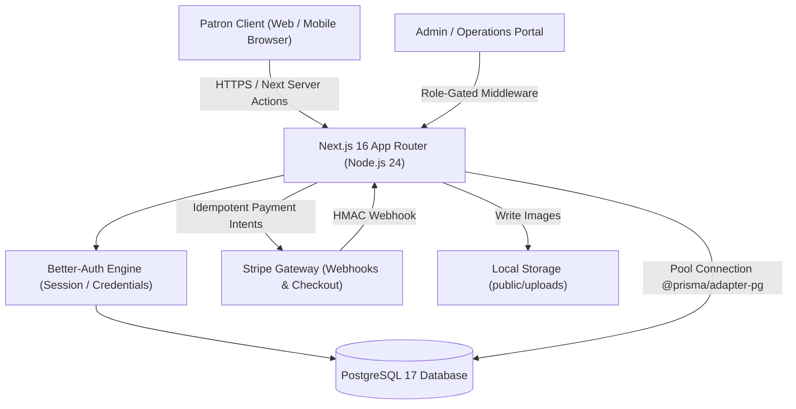

# NEXORA — Discovery & Project Intelligence Report

**Project Name:** NEXORA (High-Performance Digital Commerce Platform & Luxury Atelier)  
**Execution Date:** November 2026  
**Auditing Team:** Principal Product Engineer, Staff Software Architect, UI/UX Systems Lead, Application Security Specialist, QA Lead  
**Status:** Discovery & Baseline Complete  

---

## 1. Executive Summary & Product Identity

### 1.1 The Essence of Nexora
**NEXORA** is engineered as a modern, high-precision digital commerce platform and curated luxury atelier. It operates at the intersection of high-end horology, bespoke jewelry, audio instrumentation, couture accessories, and private client concierge services. 

- **Primary Problem Solved:** Bridging the gap between the tactile, high-trust experience of exclusive private showrooms and the speed, security, and precision of modern server-authoritative web software.
- **Value Proposition:** Curated catalog of uncompromising craftsmanship, deterministic pricing, encrypted institutional-grade checkout, private bespoke consultations, and an immersive dark-mode aesthetic.
- **Target Audience:** Discerning luxury connoisseurs, technology-driven professionals, watch collectors, high-net-worth patrons, and design enthusiasts who value minimalism, mechanical precision, and authentic provenance.
- **Primary Call to Action (CTA):** "Explore Collection" (driving catalog discovery) and "Book Private Consultation" (concierge-assisted high-ticket bespoke commissions).
- **Core Emotional Impression:** Quiet luxury, technological authority, cryptographic trust, architectural order, and timeless restraint.

---

## 2. Technical Stack & Engineering Baseline

The platform is constructed on a bleeding-edge, full-stack TypeScript stack designed for strict server authority and zero client-side tampering:

| Layer | Technology & Version | Role & Configuration | Verification Status |
|---|---|---|---|
| **Framework** | Next.js 16.3.8 (App Router) | Server Components default, Turbopack, async layouts | Verified healthy (`next build` clean) |
| **Runtime & Language** | Node.js 24.22.1 / TypeScript 5.x | High-performance V8 runtime, strict typing | Verified (`tsc --noEmit` 0 errors) |
| **Client UI Engine** | React 19.2.8 | Concurrent features, Server Actions, React Compiler discipline | Verified with React 19 idioms |
| **Styling & Design Tokens** | Tailwind CSS v4 + Radix UI + Motion | `@tailwindcss/postcss ^4`, `tw-animate-css`, `motion ^14` | Dark-only theme, CSS variable design tokens |
| **Database & Engine** | PostgreSQL 17.11 (Port 5432) | Relational engine, serializable transactions | Verified running locally via `postgres.exe` daemon |
| **ORM & Driver Adapter** | Prisma ORM 7.10.0 (`@prisma/adapter-pg`) | Type-safe queries, migration engine, connection pool | Verified (`Seed verification passed`) |
| **Authentication** | better-auth 1.7.7 | Session management, credential login, role-gating | Verified with CUSTOMER, MANAGER, ADMIN roles |
| **Payment Ingestion** | Stripe Node SDK 23.0.0 | Stripe Elements, signature verification, mock fallback | Verified with 2-layer webhook idempotency |
| **State Management** | Zustand 5.0.15 + Custom React Store | Client-side shopping bag (IDs only) & currency store | Verified with `useSyncExternalStore` hydration |
| **Form Handling & Validation** | React Hook Form 7.89 + Zod 4.6.5 | Strict schema parsing, zero runtime leak of monetary fields | Verified across checkout, auth, and admin forms |
| **Testing Infrastructure** | Vitest 5.0.3 + Playwright 1.63.0 | Unit, integration against PostgreSQL, and full E2E suites | 44/44 Vitest tests passing |

---

## 3. Git Status & Codebase Baseline

Prior to conducting this audit, the git tree was inspected to preserve all existing work and avoid discarding uncommitted user changes:

- **Current Branch:** `master` (synchronized with `origin/master`)
- **Working Tree State:** Active work-in-progress modifications exist:
  - `modified: app/(store)/product/[slug]/page.tsx`
  - `modified: components/admin/admin-nav.tsx`
  - `modified: components/concierge/concierge-dialog.tsx`
  - `modified: components/product/product-actions.tsx`
  - `modified: playwright.config.ts`
  - `modified: prisma/schema.prisma`
- **Untracked Additions:**
  - `app/admin/consultations/`
  - `app/api/admin/consultations/`
  - `app/api/consultations/`
  - `components/admin/consultation-status-select.tsx`
  - `lib/consultations.ts`
  - `prisma/migrations/20261020141057_add_consultation_requests/`
  - `scripts/clean-consultation-tests.ts`
  - `scripts/e2e-server.mjs`
  - `tests/integration/consultations.test.ts`
- **Rollback Discipline:** All existing changes are preserved intact. No destructive operations (`git reset`, `git clean`) were or will be performed.

---

## 4. Comprehensive Site Inventory (42 Surfaces)

Nexora contains 42 primary surfaces spanning storefront, authentication, customer account, admin operational center, and API routes:

### 4.1 Public Storefront Surfaces
1. `GET /` — Flagship storefront home page (Hero spotlight, curated categories, trending drops, value propositions, customer testimonials, brand philosophy, newsletter).
2. `GET /shop` — Complete catalog with multi-facet filters (category, price range, rating, in-stock status, deterministic sorting).
3. `GET /categories` — Architectural category directory showcasing all 8 disciplines.
4. `GET /category/[slug]` — Segmented category listing with dynamic breadcrumbs.
5. `GET /product/[slug]` — High-craft Product Detail Page (PDP) with multi-angle gallery, variant selector, real-time stock counters, and reviews.
6. `GET /search` — Deterministic search results page with natural language query parsing.
7. `GET /cart` — Client/server synchronized shopping bag with live server-authoritative quotes.
8. `GET /checkout` — Luxury checkout experience supporting 1-Click Saved Address, express courier selection, and Cash on Delivery.
9. `GET /shipping` — White-glove logistics, global duties, and express shipping guidelines.
10. `GET /privacy` — Legal compliance, GDPR/privacy data protection.
11. `GET /terms` — Terms of service, warranty and return legal agreements.
12. `GET /sitemap.xml` & `GET /robots.txt` — Dynamic SEO discovery endpoints.

### 4.2 Interactive Modals, Drawers & Islands
13. `CartDrawer` (`components/cart/cart-drawer.tsx`) — Slide-out shopping drawer with quick quantity controls and privilege progress.
14. `ConciergeDialog` (`components/concierge/concierge-dialog.tsx`) — Private consultation appointment modal for high-ticket pieces.
15. `SearchDialog` (`components/search/search-dialog.tsx`) — Modal command palette for instant product search.
16. `WriteReviewDialog` (`components/product/write-review-dialog.tsx`) — Modal dialog for verified customer product ratings and reviews.
17. `CurrencySelector` (`components/currency/currency-selector.tsx`) — Multi-currency conversion switcher (USD, EUR, GBP, AED, SAR).

### 4.3 Authentication & Customer Account Surfaces
18. `GET /login` — High-security patron login with password reveal protection and OAuth options.
19. `GET /register` — Client account registration with client-side role injection prevention.
20. `GET /forgot-password` — Single-use password reset link dispatcher.
21. `GET /reset-password/[token]` — Token-validated password reset form.
22. `GET /account` — Customer account hub with address manager and profile editor.
23. `GET /account/orders` — Verified order history and delivery progression list.
24. `GET /account/orders/[id]` — Detailed receipt, delivery progression, and order tracking.
25. `GET /wishlist` — Persistent patron wishlist.

### 4.4 Administrative Control Center (Role-Gated: MANAGER, ADMIN)
26. `GET /admin` — Executive Dashboard (revenue aggregates, AOV, order status distributions, low-stock alerts, AI Co-pilot).
27. `GET /admin/orders` — Order fulfillment control plane with status transition state machines.
28. `GET /admin/orders/[id]` — Deep order inspection, customer provenance, and printable invoices.
29. `GET /admin/products` — Product catalog management with SKU tracking and stock ledger history.
30. `GET /admin/products/new` — High-precision product creation with variant builders and image uploads.
31. `GET /admin/products/[id]` — Product updating, inventory adjustments, and status toggles.
32. `GET /admin/users` — Role management and account state control with last-admin deletion protection.
33. `GET /admin/consultations` — Ingestion queue for high-ticket client consultation requests.

### 4.5 Internal API Endpoints
34. `POST /api/auth/[...all]` — Better-auth identity lifecycle.
35. `POST /api/cart/quote` — Server-authoritative price calculation (strips client monetary inputs).
36. `POST /api/checkout` — Idempotent order placement with stock decrements.
37. `POST /api/coupons/validate` — Promotion and privilege code verification.
38. `POST /api/reviews` — Customer review submission with verified purchase attribution.
39. `GET /api/search` — Deterministic product search.
40. `POST /api/webhooks/stripe` — Constant-time signature verified Stripe webhook receiver.
41. `POST /api/admin/inventory` — Direct inventory adjustment with balance ledger audit.
42. `POST /api/admin/ai/copilot` — AI store assistant querying database telemetry.
43. `GET /api/admin/orders/export` — CSV and data export for operations.
44. `POST /api/admin/upload` — Local filesystem image upload with Base64 fallback.

---

## 5. External Integrations & Infrastructure Topology

---

## 6. Current Architectural Constraints & Gap Analysis

1. **Absence of Projects / Case Studies:** The database currently models physical products (`Product`), categories (`Category`), and orders (`Order`). There is **no schema entity for Bespoke Projects, Atelier Showcases, or Architectural Commissions**.
2. **Absence of Certifications:** There is **no schema entity for Certificates of Authenticity (COA), Chronometer Accreditations, Gemological Certifications, or Artisan Master Qualifications**.
3. **Storage Scalability Limitation:** The upload route (`app/api/admin/upload/route.ts`) saves files to `public/uploads` on local disk, with a Base64 string fallback. While functional locally, deploying to serverless platforms (e.g., Vercel) requires persistent cloud storage (Vercel Blob, Cloudinary, AWS S3) to prevent data loss.
4. **Admin Content Management Scope:** The Admin dashboard provides excellent CRUD for products, orders, inventory, and consultations, but lacks a dynamic Content Management System (CMS) for homepage banners, hero highlights, editorial articles, or certificate issuance.
