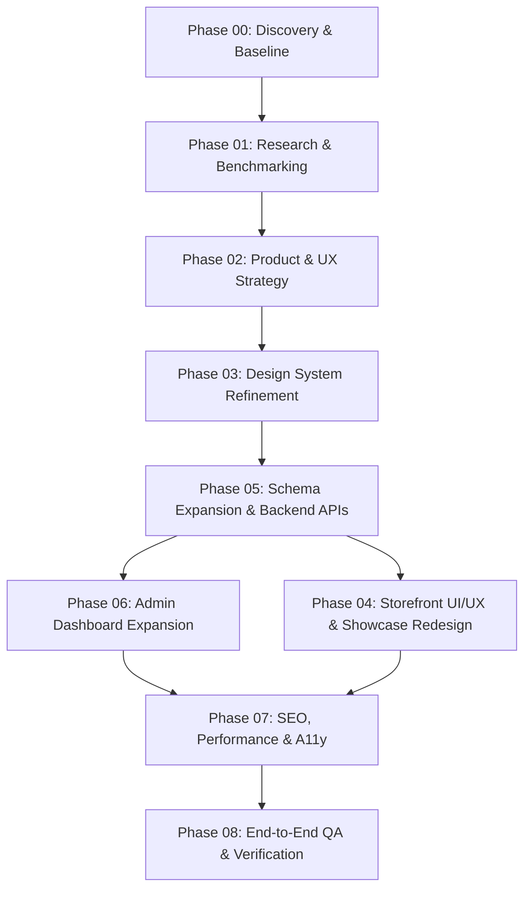

# NEXORA — Master Development & Strategic Execution Plan

**Execution Horizon:** November 2026  
**Status:** Audit & Strategic Planning Complete — Ready for Approval Gate  
**Methodology:** Phase-Gated, Evidence-Backed, Project-Native Verification  

---

## 1. Roadmap Architecture & Phase Dependencies

---

## 2. Phase-by-Phase Execution Specifications

### Phase 00 — Discovery & Baseline (COMPLETED)
- **Goal:** Comprehensive codebase inspection, environment verification, git status preservation, database connection restoration.
- **Completed Tasks:**
  - Audited 42 routes and components.
  - Initialized and started PostgreSQL 17 daemon (`pg_ctl`).
  - Verified 44/44 unit and integration tests passing.
  - Confirmed `tsc --noEmit` clean (0 type errors) and ESLint clean (0 errors).
- **Deliverables:** `docs/discovery-report.md`, `docs/website-audit.md`.

---

### Phase 01 — Research & Benchmarking (COMPLETED)
- **Goal:** Multi-source global research on elite luxury flagships, bento grids, and digital provenance systems.
- **Completed Tasks:**
  - Evaluated 10 global leaders (Bang & Olufsen, Leica, Apple Pro, Audemars Piguet, Rimowa, etc.).
  - Synthesized key trends: Bento modularity, monospaced metadata, cryptographic certificates, quiet luxury.
- **Deliverables:** `docs/design-research.md`, `docs/skills-and-tools-audit.md`.

---

### Phase 02 — Product & UX Strategy (Ready for Approval)
- **Goal:** Formally define the information architecture and functional workflows for the two critical missing pillars: **Atelier Bespoke Projects** and **Authenticity Certifications**.
- **Tasks:**
  1. Define user journeys for bespoke project discovery $\rightarrow$ private consultation request.
  2. Define public verification journey for authenticity certificates (credential ID lookup, issuing body seals).
  3. Map navigation updates: Add "Atelier & Projects" and "Certifications" to site header and footer.
- **Priority:** High | **Dependencies:** Phases 00 & 01.
- **Deliverables:** UX wireframe specs, route blueprints for `/projects` and `/certifications`.

---

### Phase 03 — Design System & Visual Token Refinement
- **Goal:** Standardize luxury design tokens and component variants in code to prepare for UI implementation.
- **Tasks:**
  1. Refine `app/globals.css` with dedicated tokens for `.text-gold-gradient`, `.shadow-glow`, and `.border-gold`.
  2. Enhance button and badge variants for certificate seals and atelier project tags.
  3. Ensure all color contrast tokens meet WCAG 2.2 AA in dark mode.
- **Files Affected:** `app/globals.css`, `components/ui/badge.tsx`, `components/ui/button.tsx`.
- **Priority:** Medium | **Dependencies:** Phase 02.
- **Verification:** Visual review and automated contrast testing.

---

### Phase 04 — Storefront UI/UX Redesign & Showcase Pages
- **Goal:** Build the public-facing exhibition surfaces for Bespoke Projects and Authenticity Certifications, and polish homepage sections.
- **Tasks:**
  1. Create `app/(store)/projects/page.tsx`: Interactive gallery of bespoke commissions with category filters (Horology, Haute Joaillerie, Acoustics), high-res imagery, materials tags, and direct consultation booking.
  2. Create `app/(store)/projects/[slug]/page.tsx`: Deep case study view with artisan craftsmanship notes, technical blueprints, and photo galleries.
  3. Create `app/(store)/certifications/page.tsx`: Gallery of official authenticity seals, master guild accreditations, and credential verification tools.
  4. Enhance Homepage (`app/(store)/page.tsx`):
     - Restructure "Exclusive Offers" into "Archival Drops & Rare Editions".
     - Add dynamic "Atelier Showcase" section previewing featured bespoke projects.
     - Add "Proof of Authenticity" badge section linking to certifications.
- **Files Affected:**
  - `[NEW] app/(store)/projects/page.tsx`
  - `[NEW] app/(store)/projects/[slug]/page.tsx`
  - `[NEW] app/(store)/certifications/page.tsx`
  - `[NEW] components/projects/project-card.tsx`
  - `[NEW] components/certifications/certification-card.tsx`
  - `[MODIFY] app/(store)/page.tsx`
  - `[MODIFY] components/layout/site-header.tsx`
  - `[MODIFY] components/layout/site-footer.tsx`
- **Priority:** High | **Dependencies:** Phases 03 & 05.
- **Verification:** Responsive testing across mobile, tablet, and desktop; zero console errors.

---

### Phase 05 — Architecture & Database Schema Expansion
- **Goal:** Extend Prisma schema and database with `Project` and `Certification` entities, execute non-destructive migrations, and implement secure API routes.
- **Tasks:**
  1. Add `Project` and `ProjectStatus` models to `prisma/schema.prisma`.
  2. Add `Certification` and `CertificateStatus` models to `prisma/schema.prisma`.
  3. Run `npm run db:migrate` to apply non-destructive migration to PostgreSQL.
  4. Create query library: `lib/queries/projects.ts` and `lib/queries/certifications.ts`.
  5. Create staff-protected API routes:
     - `POST, GET /api/admin/projects`
     - `PUT, DELETE /api/admin/projects/[id]`
     - `POST, GET /api/admin/certifications`
     - `PUT, DELETE /api/admin/certifications/[id]`
  6. Expand file upload handler (`app/api/admin/upload/route.ts`) to support PDF documents for certifications.
- **Files Affected:**
  - `[MODIFY] prisma/schema.prisma`
  - `[NEW] lib/queries/projects.ts`
  - `[NEW] lib/queries/certifications.ts`
  - `[NEW] app/api/admin/projects/route.ts`
  - `[NEW] app/api/admin/projects/[id]/route.ts`
  - `[NEW] app/api/admin/certifications/route.ts`
  - `[NEW] app/api/admin/certifications/[id]/route.ts`
  - `[MODIFY] app/api/admin/upload/route.ts`
- **Priority:** Critical | **Dependencies:** Approval Gate.
- **Verification:** Integration tests validating CRUD operations against PostgreSQL.

---

### Phase 06 — Admin Dashboard Expansion
- **Goal:** Deliver complete, zero-code management interfaces in the Admin Portal for creating, editing, publishing, and archiving Projects and Certifications.
- **Tasks:**
  1. Build `/admin/projects`: Data table of projects with thumbnail previews, status badges (`DRAFT`, `PUBLISHED`, `ARCHIVED`), and direct edit links.
  2. Build `/admin/projects/new` & `[id]`: Rich form supporting title, slug generation, client info, category, materials tag input, summary, full description, cover image upload, and multi-image gallery upload.
  3. Build `/admin/certifications`: Table of credentials with badge previews, issuing bodies, credential IDs, and active status.
  4. Build `/admin/certifications/new` & `[id]`: Form supporting title, issuing body, credential ID, verification URL, issue/expiry dates, badge upload, and PDF certificate upload.
  5. Update Admin Navigation (`components/admin/admin-nav.tsx`) with direct links to "Projects" and "Certifications".
- **Files Affected:**
  - `[NEW] app/admin/projects/page.tsx`
  - `[NEW] app/admin/projects/new/page.tsx`
  - `[NEW] app/admin/projects/[id]/page.tsx`
  - `[NEW] app/admin/certifications/page.tsx`
  - `[NEW] app/admin/certifications/new/page.tsx`
  - `[NEW] app/admin/certifications/[id]/page.tsx`
  - `[NEW] components/admin/project-form.tsx`
  - `[NEW] components/admin/certification-form.tsx`
  - `[MODIFY] components/admin/admin-nav.tsx`
- **Priority:** Critical | **Dependencies:** Phase 05.
- **Verification:** End-to-end admin workflow test: Create $\rightarrow$ Publish $\rightarrow$ Verify on Storefront $\rightarrow$ Edit $\rightarrow$ Hide $\rightarrow$ Assert removal.

---

### Phase 07 — Performance, SEO & Accessibility Hardening
- **Goal:** Ensure newly added surfaces meet strict Core Web Vitals, dynamic sitemap indexing, and WCAG 2.2 AA standards.
- **Tasks:**
  1. Update `app/sitemap.ts` to dynamically include published `/projects/*` and `/certifications` routes.
  2. Add JSON-LD schema for creative work projects and institutional credentials.
  3. Verify keyboard navigation and screen-reader accessibility on all new forms and cards.
  4. Run Lighthouse audit for performance, accessibility, and SEO.
- **Files Affected:** `app/sitemap.ts`, `app/robots.ts`.
- **Priority:** Medium | **Dependencies:** Phases 04 & 06.
- **Verification:** Fresh Lighthouse / CWV benchmark with LCP < 1.5s, 0 console errors, 0 a11y violations.

---

### Phase 08 — Quality Assurance, E2E Testing & Acceptance Criteria
- **Goal:** Rigorous automated and manual verification proving complete system integrity before sign-off.
- **Acceptance Criteria Scenarios:**
  1. **Admin Project Creation:** Admin logs in $\rightarrow$ creates project $\rightarrow$ uploads cover image $\rightarrow$ publishes $\rightarrow$ project appears on `/projects`.
  2. **Admin Project Edit & Conceal:** Admin sets project status to `DRAFT` $\rightarrow$ verifies project immediately disappears from public `/projects` without stale cache.
  3. **Admin Certification Issuance:** Admin issues credential with credential ID $\rightarrow$ verifies public display on `/certifications`.
  4. **Access Control Safeguard:** Unauthenticated patron attempting `GET /admin/projects` or `POST /api/admin/projects` receives `307 Redirect` to `/login` or `401/403 Forbidden`.
  5. **Typecheck & Test Suite:** `npm run typecheck`, `npm run lint`, and `npm test` pass with 100% green status.
- **Priority:** Critical | **Dependencies:** All preceding phases.
- **Deliverables:** `docs/NEXORA_FINAL_ACCEPTANCE_REPORT.md` with complete evidence logs.
