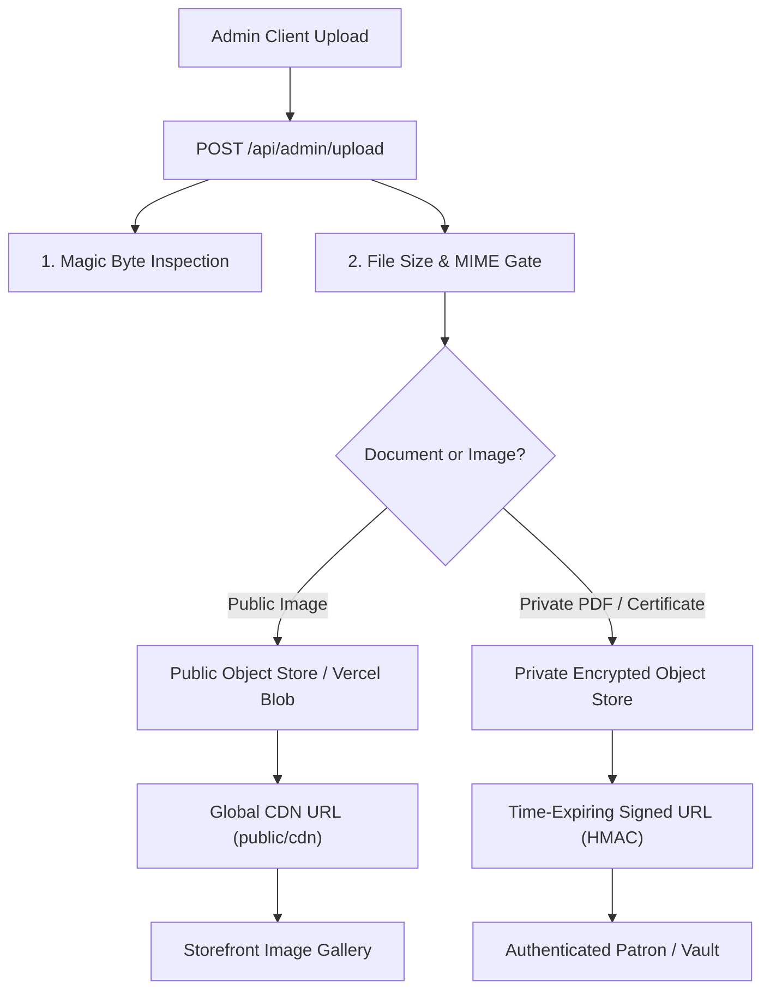

# NEXORA — Storage Architecture & File Upload Security Review

**Execution Date:** November 2026  
**Auditing Standards:** OWASP Secure File Upload Best Practices, Multi-Tier Cloud Architecture  
**Scope:** Evaluation of current local/Base64 upload mechanisms versus production-grade persistent object storage.  

---

## 1. Evaluation of Existing Storage Pipeline

### Current State (`app/api/admin/upload/route.ts`):
1. **Target Directory:** Writes files to `public/uploads/${filename}` using Node's `fs/promises`.
2. **Sanitization:** Sanitizes extension, generates suffix `${Date.now()}-${random}`.
3. **MIME Whitelist:** `image/jpeg`, `image/png`, `image/webp`, `image/avif`, `image/gif`.
4. **Fallback Mechanism:** If writing to disk throws an error (e.g. read-only filesystem), it converts the file buffer to Base64: `data:${mimeType};base64,...` and returns it as the URL.

---

## 2. Comparison of Storage Tiers: Realities & Trade-offs

| Storage Architecture | Local Dev Viability | Serverless / Cloud Production Viability | Reliability & Scalability Risks | Cost Profile |
|---|---|---|---|---|
| **Tier 1: Local Filesystem (`public/uploads`)** | **Verified Functional** | **CRITICAL FAILURE IN SERVERLESS** | On serverless platforms (Vercel, AWS Lambda), the filesystem is ephemeral and read-only outside `/tmp`. Files written to disk **disappear on the next cold start or container reboot**. | Zero external cost |
| **Tier 2: Base64 Database Fallback** | **Functional Fallback** | **VIABLE SHORT-TERM, HARMFUL AT SCALE** | Storing 5MB+ high-res images directly in PostgreSQL `text` columns causes extreme table bloat, degrades query caching, and increases DB backup sizes dramatically. | Increases DB compute & RAM costs |
| **Tier 3: Persistent Object Storage (Vercel Blob / S3 / R2)** | **Requires Credentials** | **RECOMMENDED PRODUCTION STANDARD** | High availability, global CDN edge caching, immutable asset URLs, independent access control policies (ACLs), signed URL support. | Low pay-per-GB |

---

## 3. Security Vulnerabilities in Current Implementation

1. **Client-Controlled MIME Spoofing:**
   - The route currently validates `file.type` (provided by the client's HTTP request header).
   - *Risk:* An attacker can upload a malicious script with a `.png` extension and send `Content-Type: image/png`. The current validation would accept it.
2. **Absence of PDF Support for Certifications:**
   - The current whitelist excludes `application/pdf`, preventing administrators from attaching official certificate documents or appraisal sheets.
3. **Public Exposure of Sensitive Collector Data:**
   - All files written to `public/uploads` are publicly reachable by anyone with the URL. If a certificate contains confidential appraisals or private collector details, it is immediately accessible.

---

## 4. Production-Grade Storage Architecture Proposal



---

## 5. Implementation Blueprint & Security Controls

### 5.1 Magic Byte File Signature Verification
Instead of relying solely on client-supplied `file.type`, inspect the first 4–8 bytes of the binary buffer:

```typescript
const MAGIC_BYTES = {
  jpeg: [0xFF, 0xD8, 0xFF],
  png:  [0x89, 0x50, 0x4E, 0x47],
  webp: [0x52, 0x49, 0x46, 0x46], // 'RIFF'
  pdf:  [0x25, 0x50, 0x44, 0x46], // '%PDF'
} as const;

function verifyMagicBytes(buffer: Buffer): "image/jpeg" | "image/png" | "image/webp" | "application/pdf" | null {
  if (buffer[0] === 0xFF && buffer[1] === 0xD8 && buffer[2] === 0xFF) return "image/jpeg";
  if (buffer[0] === 0x89 && buffer[1] === 0x50 && buffer[2] === 0x4E && buffer[3] === 0x47) return "image/png";
  if (buffer[0] === 0x52 && buffer[1] === 0x49 && buffer[2] === 0x46 && buffer[3] === 0x46) return "image/webp";
  if (buffer[0] === 0x25 && buffer[1] === 0x50 && buffer[2] === 0x44 && buffer[3] === 0x46) return "application/pdf";
  return null;
}
```

### 5.2 Granular Size & Format Quotas
- **Images (JPEG, PNG, WEBP, AVIF):** Maximum 10MB per file.
- **Documents & Certifications (PDF):** Maximum 15MB per file.
- Rejection of all executable, archive (`.zip`, `.rar`), or vector scripting formats (`.svg` with embedded `<script>`).

### 5.3 Public vs. Private Asset Authorization
- **Public Assets (Cover photos, product gallery, certificate badge icons):** Stored in a public read bucket with immutable cache-control headers (`public, max-age=31536000, immutable`).
- **Private Documents (Appraisal sheets, confidential provenance certificates):**
  - Stored in a private bucket with `isDocumentPrivate: true`.
  - Accessible exclusively via an authenticated API endpoint: `GET /api/certifications/[id]/document`.
  - Generates a short-lived, cryptographic signed URL (valid for 15 minutes) only after verifying that the requesting session belongs to `ADMIN` or the verified purchaser of the linked piece.

---

## 6. Pre-Implementation Evidence Contract

> [!IMPORTANT]
> **Honest Operational Status:**
> Persistent cloud object storage (e.g. `@vercel/blob` or AWS S3) is **NOT currently active or tested in this repository**. The project currently runs on local disk storage in development. Cloud storage integration is documented as an essential production milestone and must not be declared functional until integration tests prove upload, retrieval, and container restart persistence.
