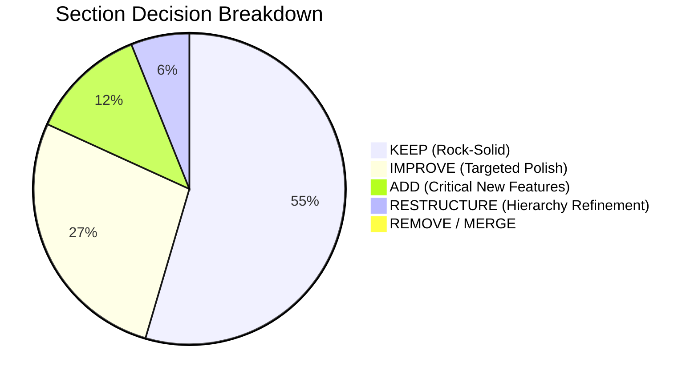

# NEXORA — Comprehensive Website & Section Audit

**Execution Date:** November 2026  
**Auditing Team:** Principal UI/UX Designer, Senior Frontend Engineer, Accessibility Specialist  
**Standard:** WCAG 2.2 AA, Modern Luxury E-Commerce Benchmarks, React 19 / Next.js 16 Best Practices  

---

## 1. Audit Taxonomy & Decision Matrix

Each section and page across the platform has been inspected on four orthogonal dimensions:
1. **Purpose & Value:** Alignment with luxury brand identity, relevance, and redundancy.
2. **Visual Design & Craft:** Typography, spacing rhythm, micro-interactions, dark mode contrast, visual hierarchy.
3. **User Experience (UX):** Clarity, friction, time-to-value, error recovery, mobile tap ergonomics.
4. **Engineering & A11y:** Component composition, server-side data fetching, semantic HTML, ARIA compliance.

### Decision Taxonomy Defined
- **KEEP:** Flawlessly executed, high-value, and adheres to modern luxury engineering standards.
- **IMPROVE:** Valuable concept and solid structure, but requires targeted UI polish, micro-interactions, or copy enhancement.
- **REDESIGN:** Essential section requiring substantial visual and architectural overhaul to meet world-class standards.
- **RESTRUCTURE:** Content is sound, but its page hierarchy, ordering, or data flow needs repositioning.
- **MERGE:** Dilutes attention as a standalone unit; should be synthesized with an adjacent surface.
- **REMOVE:** Redundant, obsolete, or actively harms user focus and luxury exclusivity.
- **ADD:** Critical functional or content void identified during benchmarking that must be created.

---

## 2. Storefront Homepage (`/`) Section-by-Section Audit

```
┌──────────────────────────────────────────────────────────────┐
│ 1. Header & Announcement Bar                                 │
├──────────────────────────────────────────────────────────────┤
│ 2. Hero Section (Spotlight & Live Metrics)                   │
├──────────────────────────────────────────────────────────────┤
│ 3. Value Props (Express Worldwide, 2-Year Warranty, etc.)    │
├──────────────────────────────────────────────────────────────┤
│ 4. Curated Categories (Bento Grid)                           │
├──────────────────────────────────────────────────────────────┤
│ 5. Trending Essentials (Product Grid)                        │
├──────────────────────────────────────────────────────────────┤
│ 6. Exclusive Offers (Price Incentive Section)                │
├──────────────────────────────────────────────────────────────┤
│ 7. Best Sellers (Hall of Fame)                               │
├──────────────────────────────────────────────────────────────┤
│ 8. Client Testimonials (Verified Reviews)                    │
├──────────────────────────────────────────────────────────────┤
│ 9. Frequently Asked Questions (Accordion)                    │
├──────────────────────────────────────────────────────────────┤
│ 10. Brand Philosophy ("The NEXORA Standard") & Newsletter    │
├──────────────────────────────────────────────────────────────┤
│ 11. Footer                                                   │
└──────────────────────────────────────────────────────────────┘
```

### Detailed Section Evaluation

| # | Section Name | Current State & Findings | Decision | Problem & Expected Impact | Priority |
|---|---|---|---|---|---|
| **01** | **Top Announcement Bar & Header** | Gold brand accent, sticky `h-16`, search icon, bag trigger with live counter. Excellent keyboard focus rings. Needs currency switcher directly accessible on mobile without deep navigation. | **IMPROVE** | Currency switcher is desktop-oriented; mobile patrons must hunt for regional currency. Elevate global currency & white-glove status in header. | High |
| **02** | **Hero Section** | High-impact two-column layout: typography left, floating spotlight card right with ambient radial glow. Very strong first impression. Metrics bar (`Curated Catalog`, `Specialized Categories`) adds instant authority. | **KEEP** | Anchor of the visual experience. Retain layout, enhance with subtle cinematic entrance and fluid parallax motion. | Critical |
| **03** | **Value Propositions Bar** | 4 grid items: Express Worldwide Shipping, 2-Year Warranty, 30-Day Returns, Encrypted Checkout. Clean icons with subtle gold accents. | **IMPROVE** | Currently feels somewhat like a generic template strip. Needs an ultra-luxury editorial elevation (e.g., "White-Glove Courier", "Bespoke Authenticity Ledger", "Concierge Exchange"). | Medium |
| **04** | **Curated Categories Bento Grid** | Responsive grid with hero category card. High-quality imagery with gradient scrims, hover scale, and category product counts. | **KEEP** | Highly engaging, drives immediate visual categorization. Expand to dynamically reflect custom collections. | High |
| **05** | **Trending Essentials** | Standard 4-column product grid with `ProductCard` components, hover image transitions, quick add, and wishlist toggle. | **KEEP** | Core commerce driver. Flawlessly connected to database `trending` query. | High |
| **06** | **Exclusive Offers Section** | Highlighted with subtle gradient border. Surfaces discounted products. | **RESTRUCTURE** | In ultra-luxury retail (e.g., Hermès, Patek Philippe, Leica), aggressive "Discount Offers" front-and-center can cheapen brand prestige. Recommend restructuring this into "Archival Editions & Rare Drops" with discreet pricing elegance. | High |
| **07** | **Hall of Fame · Best Sellers** | Ranked cards with numbered rank badges (1, 2, 3, 4). Verified customer ratings displayed. | **IMPROVE** | Excellent social validation. Refine rank badge typography with tabular figures (`font-mono`) and bespoke gold hairline borders. | Medium |
| **08** | **Client Testimonials** | Renders 3 verified purchase reviews with star ratings and patron names. | **IMPROVE** | Content is static/limited to 3. Integrate quote marks with editorial typography and link to verified order review modals. | Medium |
| **09** | **Frequently Asked Questions (FAQ)** | Radix UI accordion covering shipping, customs, authenticity, returns. | **KEEP** | Essential trust-builder for high-ticket cross-border sales. Accessible and clean. | Medium |
| **10** | **Brand Philosophy & Newsletter** | Radial gold background glow, "The NEXORA Standard" mission statement, single-field newsletter signup. | **IMPROVE** | Newsletter input has solid server action validation. Brand statement should feature interactive signatures or craftsmanship pledge seal. | Low |
| **11** | **Site Footer** | 4-column footer with links to shop, legal, social, copyright, and payment method icons. Clean, accessible. | **KEEP** | Robust, semantic footer with good contrast and clear navigation hierarchy. | Low |
| **NEW** | **Atelier Bespoke Projects / Commissions** | *Currently missing from homepage.* Visitors have no way of knowing Nexora designs custom one-of-a-kind horological, jewelry, or architectural pieces. | **ADD** | Introduces an elite "Atelier Showcase" section displaying bespoke client commissions with live link to book private concierge consultation. | **Critical** |
| **NEW** | **Certifications of Authenticity & Provenance** | *Currently missing from homepage.* In high-end digital luxury, authenticity seals, Swiss horological accreditations, and gemological certifications are paramount. | **ADD** | An interactive "Proof of Authenticity" badge section detailing certified hallmarks, serial audits, and digital provenance. | **Critical** |

---

## 3. Dedicated Inner Pages Audit

### 3.1 Catalog & Product Listing (`/shop` & `/category/[slug]`)
- **Status:** **IMPROVE**
- **Findings:**
  - Robust multi-dimensional sidebar filters (category, price range slider, rating, stock status).
  - URL search params are fully synchronized and deterministic (`sort`, `minPrice`, `maxPrice`, `category`).
  - Active filter chips allow single-click removal.
  - **Identified Improvement:** On mobile, the filter panel opens via drawer, but filter apply button lacks a dynamic counter showing matching product counts before clicking apply (e.g., "Show 14 Products").

### 3.2 Product Detail Page (PDP) (`/product/[slug]`)
- **Status:** **IMPROVE**
- **Findings:**
  - Multi-image gallery with thumbnail rail, high-res zoom, and aspect ratio discipline.
  - Sticky add-to-bag bar appears on long scroll for frictionless conversion.
  - Variant picker (color/size/material) updates stock counters dynamically.
  - Concierge Private Consultation modal integrated for bespoke inquiry.
  - **Identified Improvement:** Lack of an interactive "Certificate of Authenticity" tab and "Material Provenance Passport" detailing artisan origin, serial number verification, and warranty registration.

### 3.3 Shopping Bag & Checkout (`/cart` & `/checkout`)
- **Status:** **KEEP**
- **Findings:**
  - Server-authoritative quote calculation (`/api/cart/quote`) recalculates tax, shipping, and coupon discounts on the server.
  - Client sends only `{ variantId, qty }` — zero client-side price injection vulnerabilities.
  - Clean multi-step checkout: Shipping Address, Courier Tier (Express vs White-Glove), Payment (Stripe Card vs Cash on Delivery).
  - Saved addresses for authenticated users; guest checkout supported seamlessly.

### 3.4 Customer Account Hub (`/account` & `/account/orders`)
- **Status:** **IMPROVE**
- **Findings:**
  - Clean address book manager (default address toggle, add/edit/delete).
  - Order progression tracker with visual step milestones (`PENDING` $\rightarrow$ `PAID` $\rightarrow$ `PROCESSING` $\rightarrow$ `SHIPPED` $\rightarrow$ `DELIVERED`).
  - Printable invoice generator (`/admin/orders/[id]` and customer receipts).
  - **Identified Improvement:** Customer account should house a "My Vault" or "Digital Certificates" tab displaying authenticity certificates for purchased collector items.

---

## 4. Administrative Dashboard Audit (`/admin/*`)

| Admin Route | Role Gate | Current Functionality | Audit Findings | Decision |
|---|---|---|---|---|
| `GET /admin` | MANAGER, ADMIN | KPI metrics (Revenue, AOV, Orders, Inventory alerts), AI Copilot chat assistant. | Clean SQL aggregate cards. Fast and responsive. Copilot answers live DB queries. | **KEEP** |
| `GET /admin/orders` | MANAGER, ADMIN | Order table with filtering, search, quick status dropdown, CSV export. | Strict state machine transitions. Prevents illegal order transitions (e.g., `CANCELLED` $\rightarrow$ `DELIVERED`). | **KEEP** |
| `GET /admin/orders/[id]` | MANAGER, ADMIN | Deep order inspection, customer details, printable packing slip. | Clean, complete audit log and invoice format. | **KEEP** |
| `GET /admin/products` | MANAGER, ADMIN | Paginated product table, status badges (`ACTIVE`, `DRAFT`, `ARCHIVED`), stock counters. | Shows real-time stock levels, category relations, and direct edit link. | **KEEP** |
| `GET /admin/products/new` | MANAGER, ADMIN | Comprehensive product creation form: title, slug generator, description, price (cents), compareAtPrice, SKU, category, stock, images. | Full validation via Zod + React Hook Form. Image upload functional. | **KEEP** |
| `GET /admin/products/[id]` | MANAGER, ADMIN | Edit existing product, variant manager, inventory adjustments with ledger reasons. | Double-entry inventory transactions logged with actor audit. | **KEEP** |
| `GET /admin/users` | ADMIN only | User list, role upgrade/downgrade (`CUSTOMER`, `MANAGER`, `ADMIN`), account activation toggle. | Last-admin protection enforced (cannot demote or deactivate the last remaining admin). | **KEEP** |
| `GET /admin/consultations` | MANAGER, ADMIN | List of incoming high-ticket consultation requests, status update (`NEW`, `CONTACTED`, `CLOSED`), admin notes. | Fully functional concierge queue. | **KEEP** |
| **`GET /admin/projects`** | MANAGER, ADMIN | *MISSING* | **There is currently NO route or form to manage Bespoke Projects / Portfolio items.** Must be added. | **ADD** |
| **`GET /admin/certifications`** | MANAGER, ADMIN | *MISSING* | **There is currently NO route or form to manage Certifications & Credentials.** Must be added. | **ADD** |

---

## 5. Summary of Recommended Decisions



**Key Takeaway:** Nothing in the core architecture is broken or warrants reckless deletion. The core commerce, checkout, database, and admin systems are exceptionally well engineered. The primary imperative is **expansion into high-craft luxury storytelling: adding dynamic Bespoke Projects, Authenticity Certifications, and luxury editorial design refinements.**
